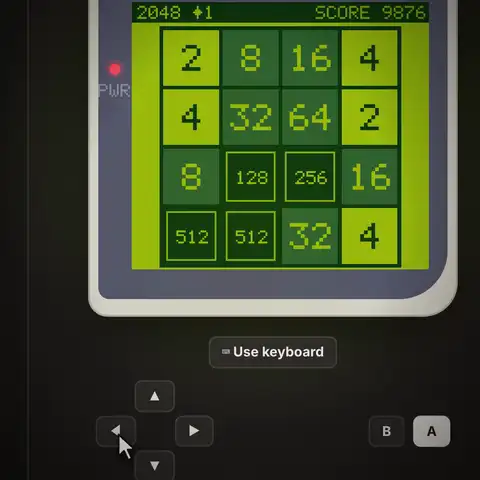
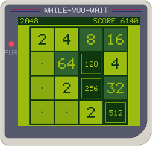
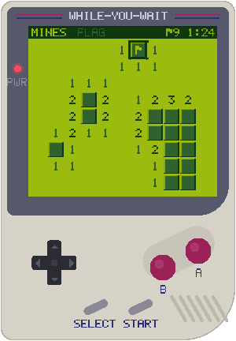
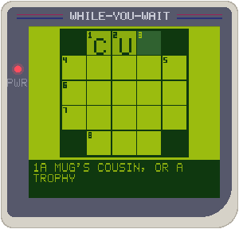
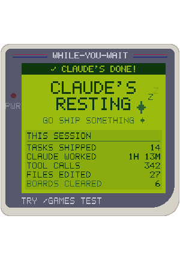

# while-you-wait

A tiny Game Boy–style arcade that lives in a side pane of Claude Code, and is
**only playable while Claude is working**. Play a quick game while Claude runs a
long task, and leave your phone alone.

<p align="center">
  
</p>

<p>
  
  
  
  
</p>

These images are drawn by the plugin's own code (`hooks/ui/device.ts`). It's a
real 160×144 LCD in the four DMG greens, with a hand-made 5×7 pixel font.

## How it works

- **`/games`** opens the pane at any time.
- When Claude has been busy for **60 seconds**, the pane opens beside the
  transcript once. It never takes keyboard focus, so it can't interrupt your typing.
- **Background agents count as Claude working.** If your turn ends while
  background agents or a workflow in the session are still running, the arcade
  stays unlocked and the screen shows how many are working (✦2; a workflow counts
  as one). *Claude's done* appears only when the last one finishes.
- **You can only play while Claude is working.** When Claude is idle, the pane
  locks and shows *"Claude's resting — go ship something"* along with your stats.
- When Claude **finishes**, or **needs you** (a permission prompt or a question),
  the game pauses and saves its exact state. A banner in the pane says
  *Claude's done* or *Claude needs you*, with a **↩ Back to Claude** button.
  v1 has no toasts, sounds or OS notifications.
- Your game resumes exactly where you left it, in this session or any other.

### Games

| Game | Controls |
| --- | --- |
| **2048** | The D-pad slides the tiles (W A S D in keyboard mode). START deals a new board. |
| **Minesweeper**: 9×9 with 10 mines, and your first dig is always safe | The D-pad moves, A digs, B flags. **FLAG** makes A plant flags. In keyboard mode: W A S D, Z digs, X flags. |
| **Mini crossword**: 30 original 5×5 puzzles | Turn on keyboard mode and type. A or Enter switches across/down, B or Backspace erases. All the clues are listed under the handheld. Puzzles you've solved are tracked. |

The buttons under the screen are real buttons: the D-pad, B, A, SELECT (back to
the menu) and START (new game). **⌨ Use keyboard** turns on keyboard mode, so
W A S D, Z (= A), X (= B) and N (new game) play the game. The desktop app only
sends a plugin's keys into a text field, so keyboard mode is a small field
that's focused for you. Arrow keys can't work there.

**`/games test`** turns on test mode: the arcade is playable anytime in that
session, whatever Claude is doing. Run it again to turn it off. The resting
screen suggests it until you've opened your first game.

### Stats that make you feel productive, not addicted

Your work stats come first and are the biggest thing on the stats screen:
tasks Claude completed, how long Claude worked, tool calls, files edited, and
how many of those tasks finished while you waited. For example: *"Claude
shipped 14 tasks while you cleared 6 boards."*

**Stats count the current session only.** They start at zero in every new
session and are never written to disk. Your games in progress and your bests
(2048 tile and score, fastest Minesweeper clears, crosswords solved) do carry
over, so you can pick up a game in any session. If several sessions are open,
they share those games safely, and one session can't overwrite progress you
made in another. There are no streaks, no "one more game" nudges, and nothing
to play while Claude is idle.

## Install

From a Claude Code terminal session:

```
/plugin install while-you-wait --marketplace nalediym/while-you-wait
```

Answer `y` to add the marketplace, then pick a scope (user is the first option).

**Claude desktop app:** `/plugin` doesn't run in the Code tab, and the app's
plugin browser only lists marketplaces you've already added. So run this once
in your shell:

```bash
claude plugin install while-you-wait --marketplace nalediym/while-you-wait
```

It installs for your user account, so new desktop sessions load it. To pick
the scope in the app instead, run
`claude plugin marketplace add nalediym/while-you-wait`, then in a Code tab
session click **+ → Plugins → Add plugin** and select **while-you-wait**.

v1 draws for the **desktop app** (`desktop` surface). Terminal support is on the roadmap.

## What it keeps

- **Your games and bests** live in Claude Code's plugin store on your machine,
  so you can pick up a game in any session.
- **Stats** live only in the session's memory.
- **No network.** The plugin makes no network calls, and nothing leaves your
  machine.
- **Developer tools are off by default.** With the `devTools` option on, it
  also keeps a timeline of its last 80 events. It never records prompts or file
  contents.

## Contributing

New games, crosswords and terminal support are all welcome.
[CONTRIBUTING.md](CONTRIBUTING.md) covers:

- how to run your copy
- the dev tools
- how the pieces fit together
- a step-by-step guide to adding a game

One command checks everything:

```bash
./scripts/check.sh
```

## Roadmap (v2)

- Claude-generated crosswords for when you run out of bundled ones
- Terminal surface support
- More games: Connect Four against the computer, match-3, a snake/food-hunt game
- Optional sound and OS notification settings

## License

MIT. The crossword grids and clues are original to this project.
